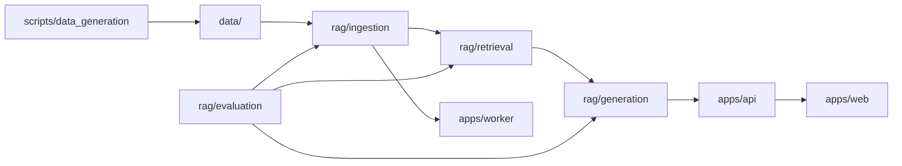
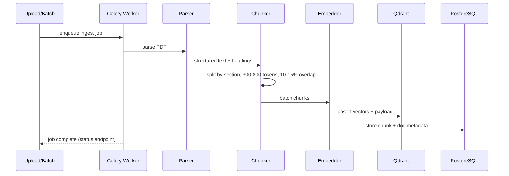
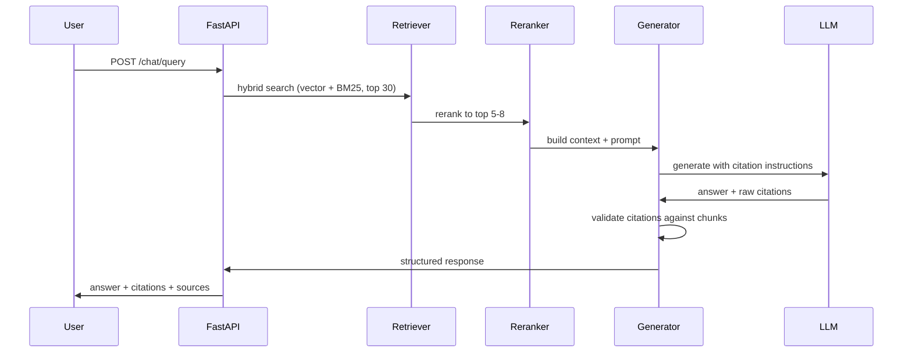

# System Design

> Folder structure, data model, and pipeline architecture.
> See [`overview.md`](./overview.md) for high-level context.

---

## Folder Structure

```
hr-policy-rag/
├── AGENTS.md                          # Coding agent entry point
├── README.md                          # Project overview
│
├── docs/
│   ├── README.md                      # Documentation index
│   ├── ARCHITECTURE.md                # Slim index to architecture docs
│   ├── IMPLEMENTATION.md              # Step-by-step checklist
│   ├── SESSION_LOG.md                 # Per-session progress
│   ├── RUNBOOK.md                     # Ops runbook
│   ├── adr/                           # Architecture Decision Records
│   └── architecture/                  # Design docs (this folder)
│
├── .cursor/rules/                     # Cursor agent rules
├── apps/                              # Deployable services (api, worker, web)
├── rag/                               # Core RAG library
├── data/                              # Schemas, templates, documents, eval
├── scripts/data_generation/           # Synthetic PDF generation
├── infra/                             # Docker configs
└── tests/                             # Unit & integration tests
```

Full tree with file-level detail:

```
apps/
├── api/           # FastAPI — routes, middleware, schemas
├── worker/        # Celery — async ingestion tasks
└── web/           # Streamlit chat UI

rag/
├── config.py
├── ingestion/     # parser, chunker, embedder, indexer, pipeline
├── retrieval/     # hybrid, reranker, filters, context_builder
├── generation/    # prompts, llm, citations
└── evaluation/    # golden_runner, metrics, ragas_runner

data/
├── schemas/       # JSON Schema definitions
├── templates/     # HTML templates + LLM prompts
├── seed/          # Company profiles
├── documents/     # Generated PDFs (gitignored at scale)
├── metadata/      # Per-document metadata JSON
└── eval/          # golden_qa.json + eval_results/
```

## Module Dependency Graph



---

## Data Model

### Company Profile

```json
{
  "company_id": "novatech-solutions",
  "name": "NovaTech Solutions",
  "industry": "technology",
  "region": "US",
  "size": "mid-size",
  "employee_count": 500
}
```

### Policy Document Metadata

```json
{
  "doc_id": "novatech-solutions-leave-policy-2024",
  "company_id": "novatech-solutions",
  "policy_type": "leave_policy",
  "title": "Leave Policy",
  "version": "2024-01",
  "effective_date": "2024-04-01",
  "status": "active",
  "file_path": "data/documents/novatech-solutions/leave_policy_2024.pdf",
  "parameters": {
    "annual_leave_days": 20,
    "probation_months": 3,
    "carry_forward_limit": 5
  }
}
```

### Chunk Metadata (Qdrant payload + PostgreSQL)

```json
{
  "chunk_id": "novatech-leave-2024-chunk-012",
  "doc_id": "novatech-solutions-leave-policy-2024",
  "company_id": "novatech-solutions",
  "policy_type": "leave_policy",
  "section": "Annual Leave Entitlement",
  "page": 4,
  "chunk_index": 12,
  "version": "2024-01",
  "status": "active",
  "token_count": 412
}
```

### Golden Eval Q&A

```json
{
  "id": "eval-001",
  "question": "How many annual leave days do full-time employees get at NovaTech?",
  "expected_answer_contains": ["20 days"],
  "source_doc_id": "novatech-solutions-leave-policy-2024",
  "source_section": "Annual Leave Entitlement",
  "company_id": "novatech-solutions",
  "difficulty": "easy",
  "answerable": true
}
```

### Policy Types (10 types × N companies)

| # | Policy Type | Slug |
|---|-------------|------|
| 1 | Leave & Time Off | `leave_policy` |
| 2 | Remote Work | `remote_work` |
| 3 | Code of Conduct | `code_of_conduct` |
| 4 | Benefits & Insurance | `benefits` |
| 5 | Expense Reimbursement | `expense` |
| 6 | Performance Review | `performance` |
| 7 | Onboarding | `onboarding` |
| 8 | Termination & Exit | `termination` |
| 9 | Data Security / IT | `data_security` |
| 10 | Travel Policy | `travel` |

JSON schemas live in `data/schemas/`. See [ADR-002](../adr/002-synthetic-data.md).

---

## Pipeline Architecture

### Ingestion Pipeline (async)



**Steps:**

1. **Parse** — PyMuPDF extract text + detect headings/sections/pages
2. **Chunk** — Structure-aware: split on headings first, then token window with overlap
3. **Embed** — Batch embed via OpenAI; store model version in metadata
4. **Index** — Upsert to Qdrant with full payload; insert metadata rows in PostgreSQL
5. **Validate** — Verify chunk count, embedding dimensions, no duplicate chunk_ids

### Query Pipeline (sync)



**Steps:**

1. **Optional query rewrite** — Expand abbreviations (PTO → paid time off)
2. **Hybrid retrieval** — Qdrant vector search + BM25 keyword search, merge scores
3. **Metadata filter** — `company_id`, `status=active`, latest `version`
4. **Rerank** — Cross-encoder scores query-chunk pairs; keep top 5–8
5. **Context assembly** — Format chunks with `[doc_title | section | page]` headers
6. **Generate** — LLM with strict context-only system prompt
7. **Citation validation** — Ensure cited doc_ids exist in retrieved chunks
8. **Response** — JSON with answer, citations, confidence, retrieved chunk refs

### API Response Schema

```json
{
  "answer": "Full-time employees at NovaTech receive 20 days of annual leave...",
  "citations": [
    {
      "doc_id": "novatech-solutions-leave-policy-2024",
      "title": "Leave Policy",
      "section": "Annual Leave Entitlement",
      "page": 4
    }
  ],
  "confidence": "high",
  "retrieved_chunks": 5,
  "request_id": "req-abc123"
}
```

## Related Docs

- [Overview](./overview.md)
- [Operations](./operations.md)
- [Implementation checklist](../IMPLEMENTATION.md)
