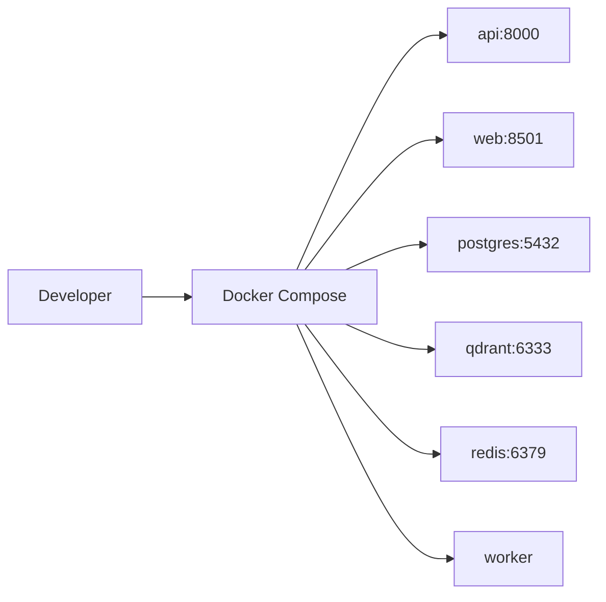
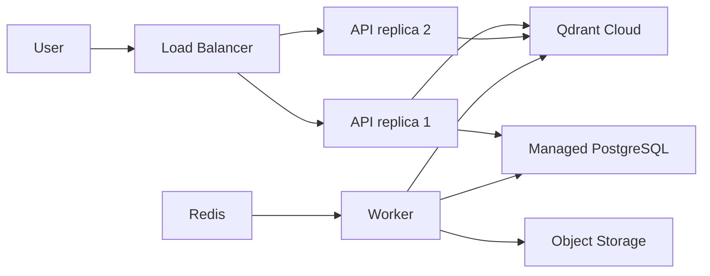

# Production Operations

> Production requirements, evaluation strategy, deployment, and observability.
> For implementation tasks, see [`../IMPLEMENTATION.md`](../IMPLEMENTATION.md).

---

## Production Requirements

### Non-Functional Requirements

| Requirement | Target |
|-------------|--------|
| Query latency (p95) | < 3 seconds |
| Ingestion throughput | ≥ 10 docs/min (with worker) |
| Availability | 99.5% (single-region MVP) |
| Max question length | 500 characters |
| Max upload size | 10 MB per PDF |
| Concurrent queries | 50 (MVP) |

### Security (MVP)

- [ ] API key authentication
- [ ] No PII in logs
- [ ] Rate limiting
- [ ] CORS restricted to frontend origin
- [ ] Secrets via environment variables only

### Data Governance

- [ ] Document version tracking
- [ ] Chunk status: `active` | `archived`
- [ ] Company-scoped retrieval (multi-tenant filter)
- [ ] Audit log for document uploads (who, when)

---

## Evaluation Strategy

### Golden Set Composition (target: 80 questions for MVP)

| Category | Count | Example |
|----------|-------|---------|
| Easy factual | 30 | "How many leave days?" |
| Multi-section | 20 | "What is the leave + remote work policy for probation?" |
| Version-specific | 10 | "What changed in 2024 leave policy?" |
| Unanswerable | 10 | "What is the CEO's salary?" |
| Cross-policy | 10 | "Can I work remotely during maternity leave?" |

### Metrics

| Metric | Formula | Target |
|--------|---------|--------|
| Recall@5 | correct doc in top 5 retrieved | ≥ 0.85 |
| Citation accuracy | cited doc ∈ retrieved chunks | ≥ 0.90 |
| Answer faithfulness | answer supported by context (RAGAS) | ≥ 0.80 |
| "I don't know" accuracy | correctly refuses unanswerable | ≥ 0.80 |
| Latency p95 | query end-to-end | < 3s |

### Eval Workflow

```bash
# After any retrieval or generation change:
make eval

# Output:
# Recall@5:        0.87  ✓
# Citation acc:    0.92  ✓
# Faithfulness:    0.83  ✓
# Refusal acc:     0.90  ✓
# Latency p95:     2.1s  ✓
```

---

## Deployment Architecture

### Local Development



### Production (target)



### CI/CD Pipeline (Phase 12)

```
Push → GitHub Actions → lint + unit tests → integration tests → eval threshold check → deploy
```

---

## Observability

### Structured Log Format

```json
{
  "timestamp": "2026-08-17T12:00:00Z",
  "level": "INFO",
  "request_id": "req-abc123",
  "event": "query_complete",
  "company_id": "novatech-solutions",
  "question_length": 45,
  "retrieved_chunks": 5,
  "rerank_top_score": 0.92,
  "llm_model": "gpt-4o-mini",
  "latency_ms": 1840,
  "citation_count": 1
}
```

### Key Dashboards (Phase 10+)

- Query volume & latency (p50, p95, p99)
- Retrieval Recall@5 (from periodic eval runs)
- "I don't know" rate
- User feedback (thumbs up/down ratio)
- Ingestion job success/failure rate
- Error rate by endpoint

### Runbook Scenarios

See [`../RUNBOOK.md`](../RUNBOOK.md) for detailed procedures:

- Bad answers after doc update → re-ingest + verify chunk status
- High latency → check reranker, reduce top-k, check Qdrant health
- Ingestion failures → check worker logs, PDF parse errors
- Eval score drop after change → bisect retrieval vs generation

## Related Docs

- [Design](./design.md) — data model and pipelines
- [Runbook](../RUNBOOK.md) — on-call procedures
- [Implementation checklist](../IMPLEMENTATION.md) — Phases 7, 9, 10, 12
