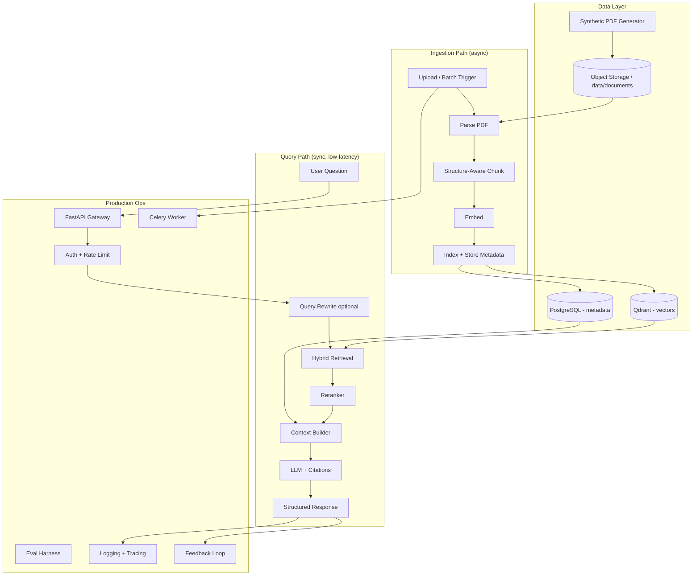

# System Overview

> Part of the architecture docs. See [`../ARCHITECTURE.md`](../ARCHITECTURE.md) for the full index.

---

## Problem Statement

Employees need accurate, cited answers from HR policy documents. Generic chatbots hallucinate; production RAG requires governed retrieval, versioning, evaluation, and observability.

## High-Level Architecture

## Design Principles

| Principle | Implementation |
|-----------|----------------|
| Grounded answers | Context-only prompts; mandatory citations |
| Fail safely | "I don't know" when context insufficient |
| Versioned data | Chunk metadata includes `version`, `status` |
| Measurable quality | Golden eval set + RAGAS metrics |
| Async ingestion | Celery workers; API never blocks on embed |
| Session continuity | AGENTS.md + IMPLEMENTATION.md + SESSION_LOG + ADRs |

## Corpus Scale Plan

| Stage | Documents | Purpose |
|-------|-----------|---------|
| MVP | **50 PDFs** | 5 companies × 10 policy types — build & validate pipeline |
| Scale test | **300–400 PDFs** | Ingestion throughput, index size, retrieval latency |
| Stress test | **500 PDFs** | Production-level load testing |

## Related Docs

- [Design details](./design.md) — folder structure, data model, pipelines
- [Operations](./operations.md) — production requirements, deployment, observability
- [Implementation checklist](../IMPLEMENTATION.md) — what to build next
- [ADR-002: Synthetic Data](../adr/002-synthetic-data.md) — data strategy
